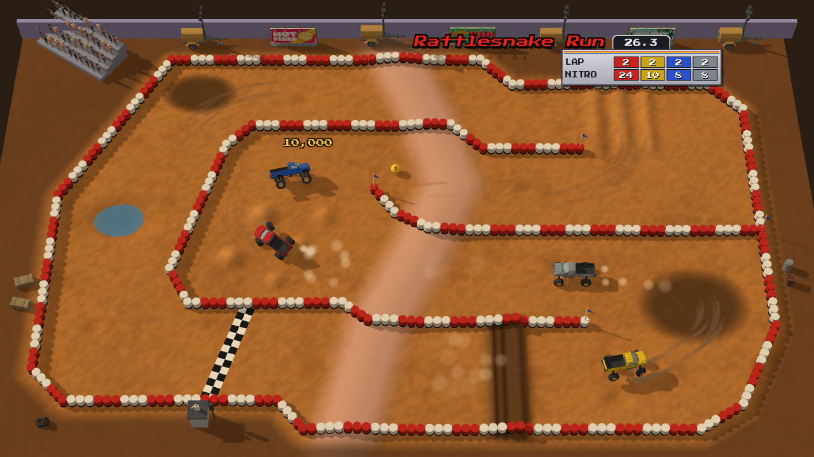
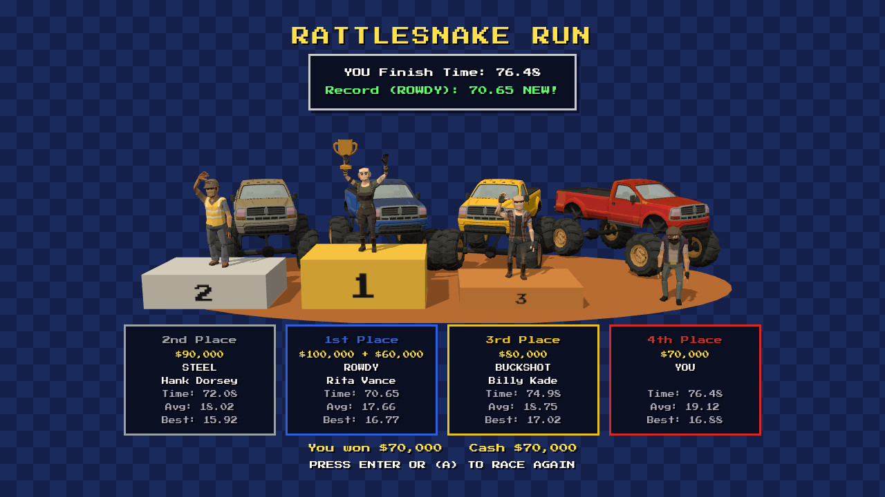
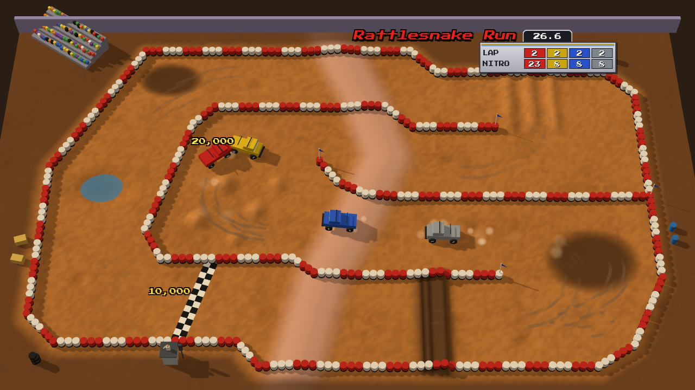
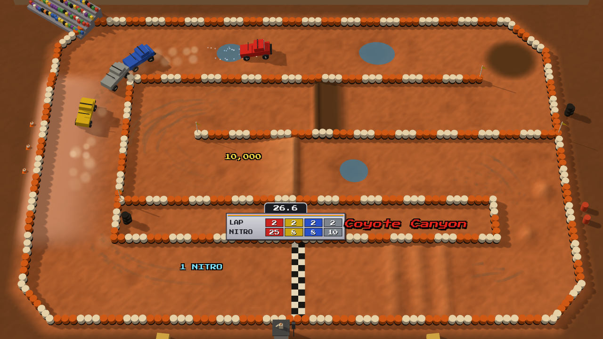
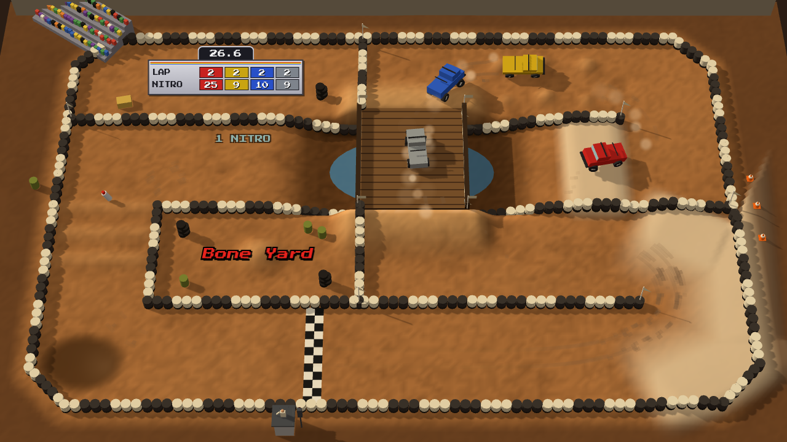
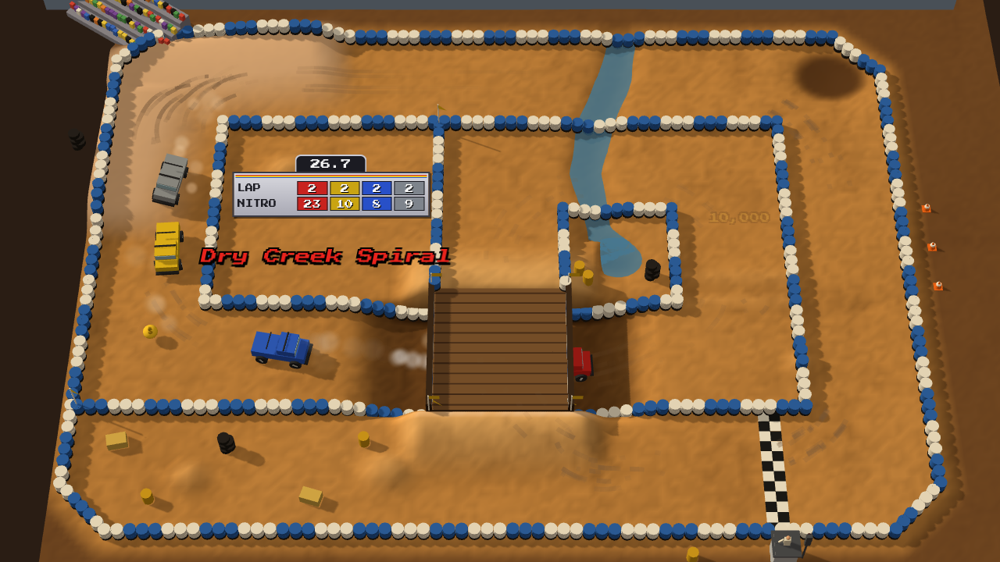
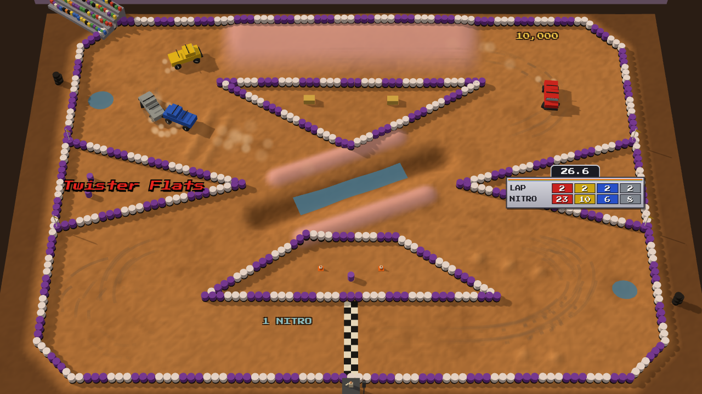
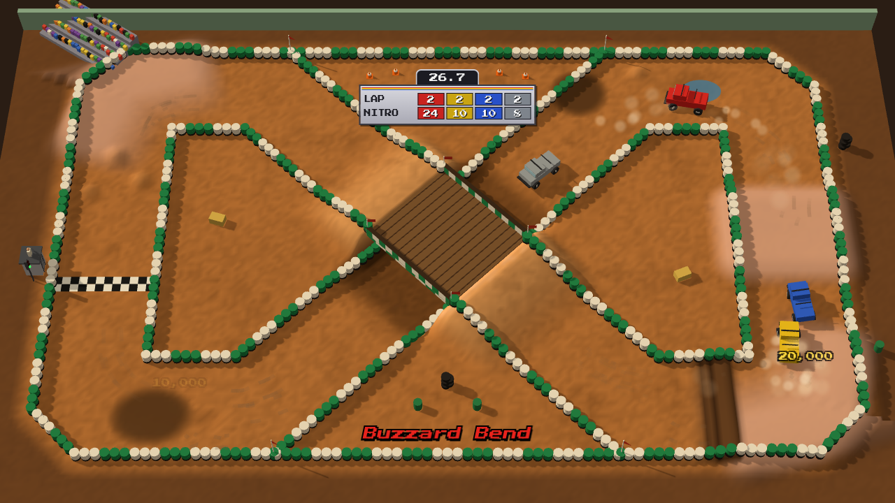
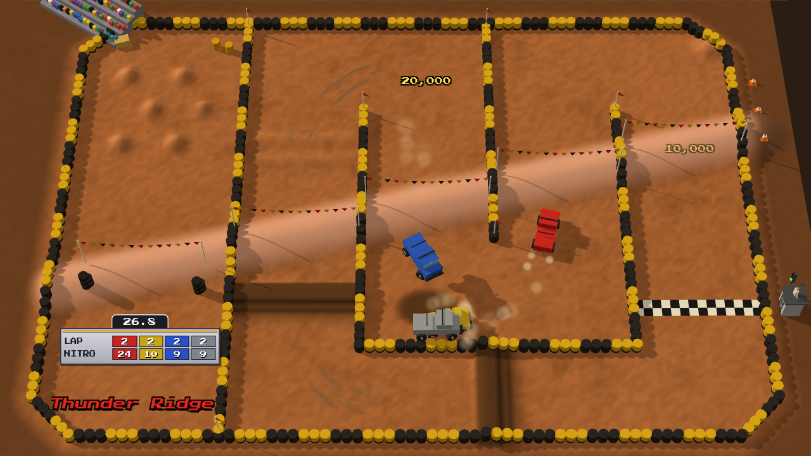
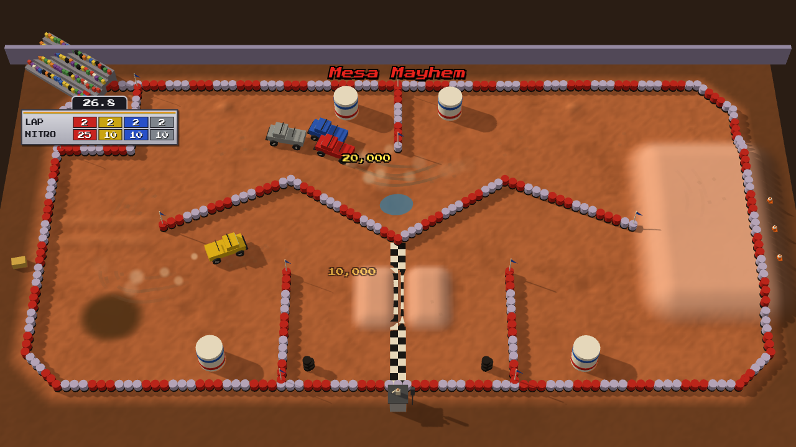

# Off Road

A 3D arcade off-road racer in the browser. Four trucks, one track per screen seen from high above, jumps, whoops,
water and nitros. It is built with three.js and Rapier, and its models come from Synty assets through an
agent-driven asset pipeline: the game asks a command-line tool for game-ready GLB models and never touches the
source assets by hand.



**Status:** all eight tracks and a full race on each, forward or reversed. Four trucks race four laps; three CPU
drivers follow the racing line, bump you, fire nitros on the straights and pick up money bags and nitro bottles.
A flagman and a lamp tree start the race; the podium pays $100K / $90K / $80K / $70K and keeps the track record.
The trucks are placeholder boxes until the generator's 3D export lands; the season and shop come next (`TODO.md`).



## Tracks

Eight stadium tracks in season order, each also raced in reverse (`?scene=race&track=<id>&reverse`).

| | |
|---|---|
|  **Rattlesnake Run** (`rattlesnake`): a four-pass serpentine with a ridge across every lane, a plank jump, whoops and mud. |  **Coyote Canyon** (`coyote`): long straights, a banked lane, puddles, a plank ramp and a jump over a pool. |
|  **Bone Yard** (`boneyard`): a figure-8 whose connector crosses a deep water pit on a bridge; bone-pile moguls. |  **Dry Creek Spiral** (`drycreek`): a spiral that exits over its own inner ring on a bridge, with a creek across two lanes. |
|  **Twister Flats** (`twister`): an open figure-8 whose crossing is a jump over a water channel between two berms. |  **Buzzard Bend** (`buzzard`): a bow-tie figure-8 whose diagonals cross on a striped plank bridge. |
|  **Thunder Ridge** (`thunder`): one long ridge across four columns, a jump under bunting at every crossing. |  **Mesa Mayhem** (`mesa`): a snake around a zig-zag island, a mesa to fly off, tabletops and giant drums. |

## Controls

| | Keyboard | Gamepad |
|---|---|---|
| Gas | Up / W | RT or A |
| Brake / reverse | Down / S | LT or X |
| Steer | Left, Right / A, D | Left stick or d-pad |
| Nitro | Space or Shift | B, Y or RB |
| Reset (race: back to Get Ready!) | R | Back |
| Race again (results) | Enter | A or Start |
| Debug overlay | F3 | |

## Develop

```sh
npm install
npm run dev          # http://localhost:5199/?scene=race  (a race on track 1; &track=<id>, &reverse, &debug, &autopilot)
                     # http://localhost:5199/?scene=test  (one truck on the proving ground)
npm run typecheck
npm run assets       # export the models listed in ssg.models.json into public/models
node scripts/load-check.mjs http://localhost:5199 test   # boots headless, saves test-results/test.png
node scripts/load-check.mjs http://localhost:5199 race   # the race scene, saves test-results/race.png
node scripts/drive-check.mjs http://localhost:5199       # scripted drive: throttle, turn, nitro jump
node scripts/load-check.mjs http://localhost:5199 race track=mesa reverse   # any track, either way
node scripts/race-check.mjs http://localhost:5199        # a full 4-lap race on autopilot to the results
node scripts/race-check.mjs http://localhost:5199 buzzard --reverse
node scripts/track-map.mjs http://localhost:5199 twister # a top-down layout map + line/gate/wall lint
node scripts/hit-probe.mjs http://localhost:5199 thunder # where trucks hit walls or get rescued
node scripts/lap-probe.mjs http://localhost:5199         # lap times for feel tuning
node scripts/feel-probe.mjs                              # physics numbers for tuning
node scripts/record.mjs http://localhost:5199 gameplay   # test-results/video/gameplay.mp4
npm run build        # dist/ (relative base, ready for GitHub Pages)
node scripts/deploy-pages.mjs                            # build and push gh-pages
```

Models are generated locally and are not committed: Synty assets can't be redistributed as source files.

## Credits

3D models: Synty Studios POLYGON packs, used under the Synty Store EULA.
Font: Press Start 2P by CodeMan38 (SIL Open Font License), via @fontsource.
