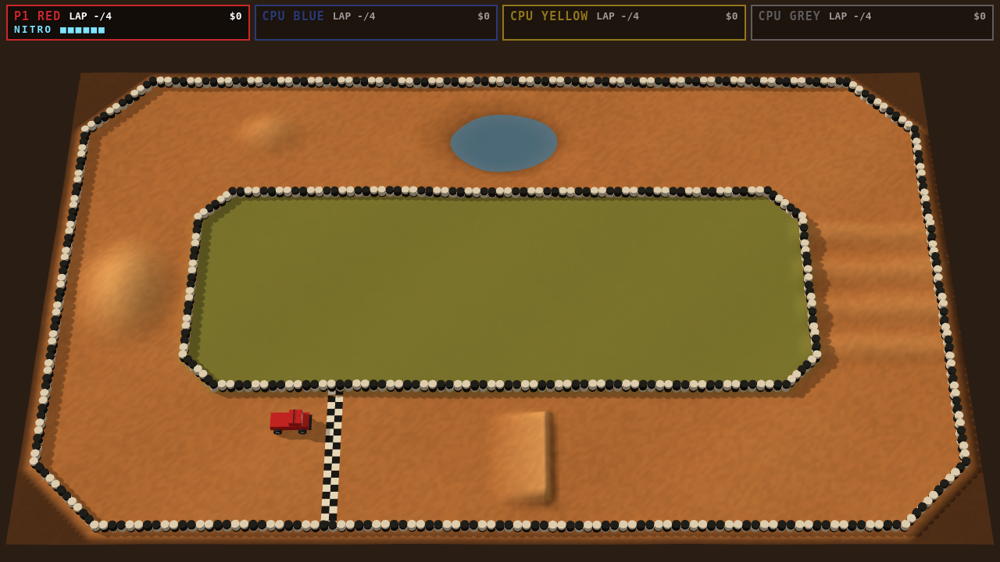

# Off Road

A 3D arcade off-road racer in the browser. Four trucks, one track per screen seen from high above, jumps, whoops,
water and nitros. It is built with three.js and Rapier, and its models come from Synty assets through an
agent-driven asset pipeline: the game asks a command-line tool for game-ready GLB models and never touches the
source assets by hand.



**Status:** early. A placeholder box truck drives the test track with real suspension, jumps and nitro bursts.
Tracks, CPU trucks, races and the season come next (see `TODO.md`).

## Controls

| | Keyboard | Gamepad |
|---|---|---|
| Gas | Up / W | RT or A |
| Brake / reverse | Down / S | LT or X |
| Steer | Left, Right / A, D | Left stick or d-pad |
| Nitro | Space or Shift | B, Y or RB |
| Reset to the grid | R | Back |
| Debug overlay | F3 | |

## Develop

```sh
npm install
npm run dev          # http://localhost:5199/?scene=test  (add &debug for the overlay)
npm run typecheck
npm run assets       # export the models listed in ssg.models.json into public/models
node scripts/load-check.mjs http://localhost:5199 test   # boots headless, saves test-results/test.png
node scripts/drive-check.mjs http://localhost:5199       # scripted drive: throttle, turn, nitro jump
node scripts/feel-probe.mjs                              # physics numbers for tuning
node scripts/record.mjs http://localhost:5199 gameplay   # test-results/video/gameplay.mp4
npm run build        # dist/ (relative base, ready for GitHub Pages)
node scripts/deploy-pages.mjs                            # build and push gh-pages
```

Models are generated locally and are not committed: Synty assets can't be redistributed as source files.

## Credits

3D models: Synty Studios POLYGON packs, used under the Synty Store EULA.
