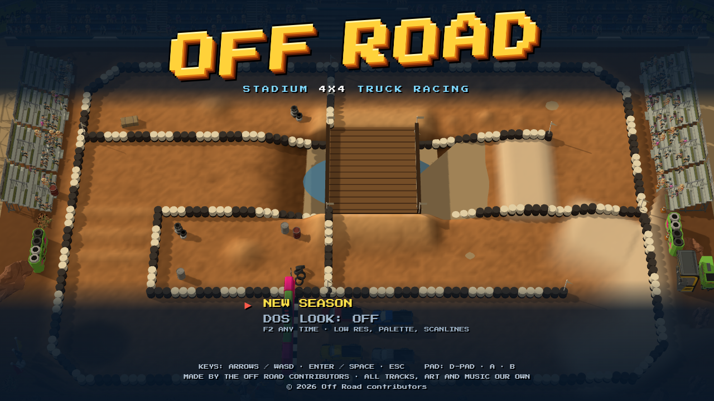
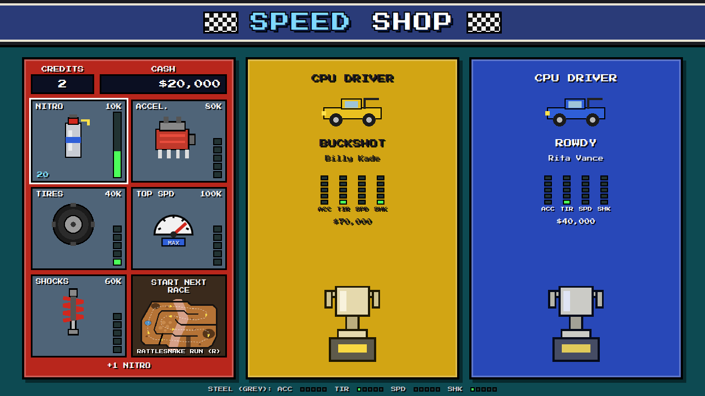
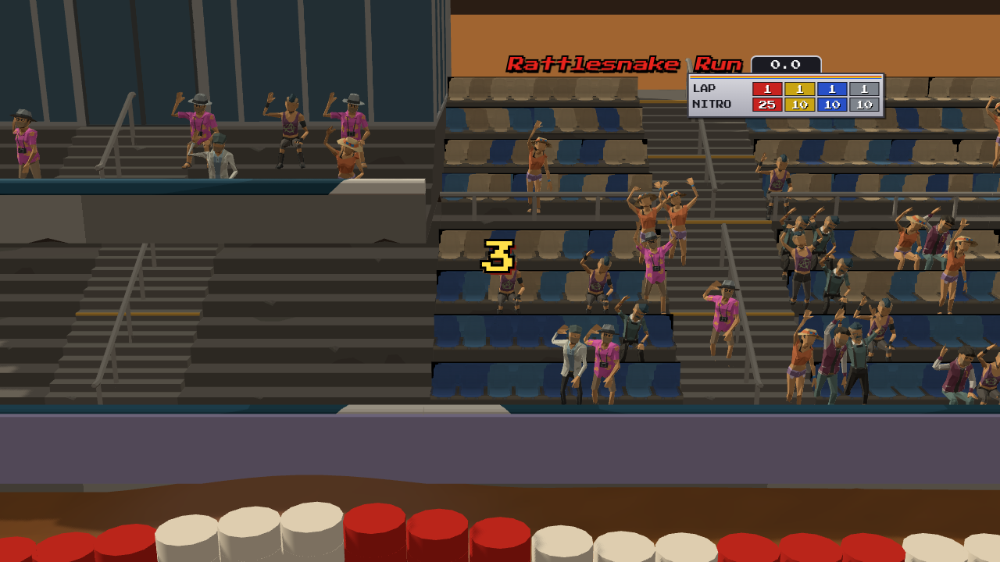
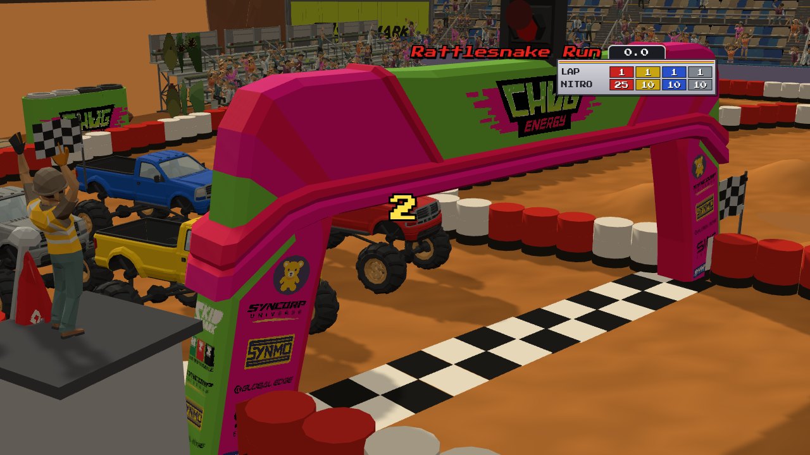
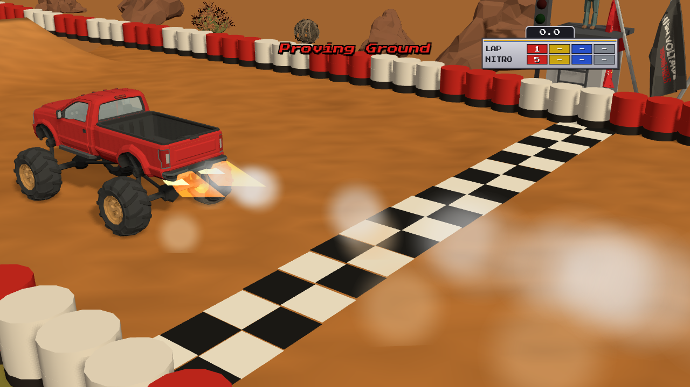
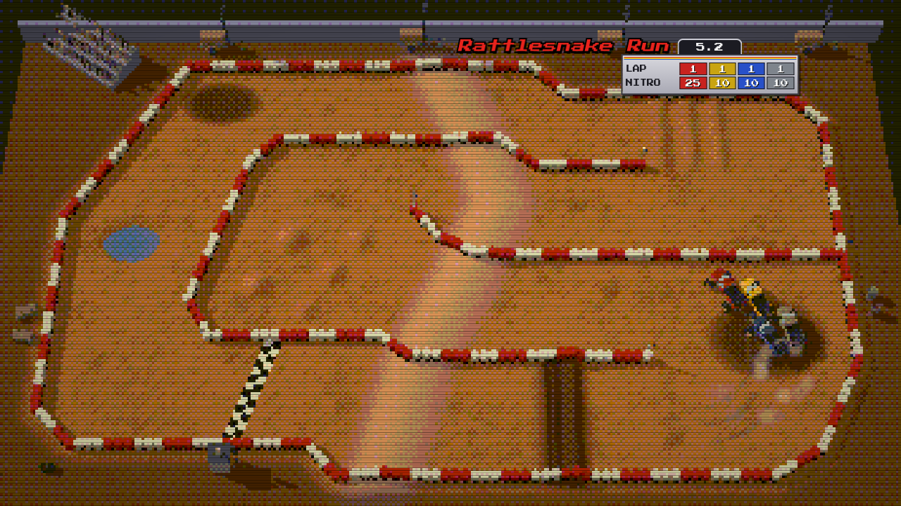

# Off Road

[](https://ali3b.github.io/offroad/videos/offroad-trailer.mp4)

**[Play it in your browser: ali3b.github.io/offroad](https://ali3b.github.io/offroad/)** ·
[Trailer](https://ali3b.github.io/offroad/videos/offroad-trailer.mp4) ·
[Gallery](https://ali3b.github.io/offroad/gallery.html)

A 3D arcade off-road racer in the browser. Four trucks, one stadium track per screen seen from high above, jumps,
whoops, mud, water and nitros. It is built with three.js and Rapier, and its models come from Synty assets through an
agent-driven asset pipeline: the game asks a command-line tool for game-ready GLB models and never touches the
source assets by hand.

## Features

- **Eight stadium tracks**, each also raced in reverse: bridges, a jump crossing, banked lanes, plateaus, a creek,
  whoops, mud and water.
- **Four-truck, four-lap races** against three CPU drivers who follow the racing line, bump you, fire nitros on the
  straights and grab money bags and nitro bottles. A flagman on his tower and a start light on the sponsor arch
  start every race; a nitro burst lights a flame out of the back of the truck.
- **A season**: sign up with your initials and truck colour, win prize money ($100K / $90K / $80K / $70K), keep
  your credits by beating every CPU truck, and spend your cash in the **Speed Shop** (nitro, acceleration, tires,
  shocks, top speed). The track rotation adds tracks and flips their direction as the season goes on.
- **A 3D podium** after every race: the top three drivers on the podium in front of their trucks, the winner beating
  their chest and lifting the cup under confetti, 2nd clapping, 3rd fist-pumping, 4th hanging their head; prize
  money, times and the track record.
- **A stadium** round every track: grandstands with a VIP box along the back and bleachers down the sides, full of
  seated fans who jump up and cheer at the finish and at big jumps; sponsor billboards, flags and tyre barriers, a pit
  wall, and the desert outside with cacti, rocks and tumbleweeds rolling in the wind. Each track has its own desert.
- **FM-style music and sound effects** synthesised in the browser: engines, skids, splashes, crashes, countdown.
- **A title screen with a demo race** and an attract loop with racing hints.
- **The DOS look** (F2): 200 lines, a 256- or 16-colour palette and scanlines.
- **Local multiplayer for up to 3 players** (red, yellow, blue; grey is always the CPU boss): each joins at the
  sign-up with their own keys or pad, and has their own cash, credits, upgrades and turn at the Speed Shop.
- Keyboard and gamepad.











## Tracks

Eight stadium tracks in season order, each also raced in reverse (`?scene=race&track=<id>&reverse`).

| | |
|---|---|
|  **Rattlesnake Run** (`rattlesnake`): a four-pass serpentine with a ridge across every lane, a plank jump, whoops and mud. |  **Coyote Canyon** (`coyote`): long straights, a banked lane, puddles, a plank ramp and a jump over a pool. |
|  **Bone Yard** (`boneyard`): a figure-8 whose connector crosses a deep water pit on a bridge; bone-pile moguls. |  **Dry Creek Spiral** (`drycreek`): a spiral that exits over its own inner ring on a bridge, with a creek across two lanes. |
|  **Twister Flats** (`twister`): an open figure-8 whose crossing is a jump over a water channel between two berms. |  **Buzzard Bend** (`buzzard`): a bow-tie figure-8 whose diagonals cross on a striped plank bridge. |
|  **Thunder Ridge** (`thunder`): one long ridge across four columns, a jump under bunting at every crossing. |  **Mesa Mayhem** (`mesa`): a snake around a zig-zag island, a mesa to fly off, tabletops and giant drums. |

## Controls

| | Keyboard | Gamepad |
|---|---|---|
| Gas | Up / W | RT or A |
| Brake / reverse | Down / S | LT or X |
| Steer | Left, Right / A, D | Left stick or d-pad |
| Nitro | Space or Shift | B, Y or RB |
| Reset (standalone race: back to Get Ready!) | R | Back |
| Menus: move / confirm / back | Arrows or WASD / Enter or Space / Esc | D-pad or stick / A or Start / B |
| Race again (standalone race results) | Enter | A or Start |
| Mute | M | |
| DOS look (off, 256, 16 colours) | F2 | |
| Debug overlay | F3 | |

**Local multiplayer (2–3 players).** At the driver sign-up each player joins a colour panel by pressing their start
key or (A) on a pad, enters initials and confirms READY; colours nobody joins race as CPU drivers. With one player the
whole keyboard and every pad drive the one truck (the table above); with two or three the keyboard splits:

| Players | Player on the WASD side | Player on the arrows side | Third player |
|---|---|---|---|
| 1 | Arrows or WASD, Space / Shift = nitro, any pad | | |
| 2–3 | W A S D, **Left Shift** = nitro (joins with W or Left Shift) | Arrows, **Right Ctrl** or Enter = nitro (joins with Up or Enter) | Gamepad only (joins with A) |

Every player can also drive with a pad: a player who joined with a pad keeps it; the other pads are lent to the
keyboard players in join order. In the menus each player's keys / pad act for them (the Speed Shop is visited in
turn); Esc works for whoever is up.

## Develop

```sh
npm install
npm run dev          # http://localhost:5199/             (the title: a season with the shop between races)
                     # http://localhost:5199/?scene=race  (a race on track 1; &track=<id>, &reverse, &debug, &autopilot)
                     # http://localhost:5199/?scene=shop  (straight into the Speed Shop)
                     # http://localhost:5199/?scene=test  (one truck on the proving ground)
npm run typecheck
npm run assets       # export the models listed in ssg.models.json into public/models
node scripts/load-check.mjs http://localhost:5199 test   # boots headless, saves test-results/test.png
node scripts/load-check.mjs http://localhost:5199 race   # the race scene, saves test-results/race.png
node scripts/drive-check.mjs http://localhost:5199       # scripted drive: throttle, turn, nitro jump
node scripts/load-check.mjs http://localhost:5199 race track=mesa reverse   # any track, either way
node scripts/race-check.mjs http://localhost:5199        # a full 4-lap race on autopilot to the results
node scripts/season-check.mjs http://localhost:5199      # the season flow: 3 races, the shop, credits, continue
node scripts/twoplayer-check.mjs http://localhost:5199   # local multiplayer: 2 players join with keys, shop in turn, credits per player
npm test                                                 # unit tests (track rotation, shop, credits)
node scripts/race-check.mjs http://localhost:5199 buzzard --reverse
node scripts/track-map.mjs http://localhost:5199 twister # a top-down layout map + line/gate/wall lint
node scripts/hit-probe.mjs http://localhost:5199 thunder # where trucks hit walls or get rescued
node scripts/lap-probe.mjs http://localhost:5199         # lap times for feel tuning
node scripts/feel-probe.mjs                              # physics numbers for tuning
node scripts/record.mjs http://localhost:5199 gameplay   # test-results/video/gameplay.mp4 (one scripted lap)
node scripts/trailer.mjs http://localhost:5199           # the trailer with sound, the short and the GIF
npm run build        # dist/ (relative base, ready for GitHub Pages)
node scripts/deploy-pages.mjs --no-push                  # dist/ + models + videos + gallery.html, no push
node scripts/deploy-pages.mjs                            # the same, then push gh-pages
```

Models are generated locally and are not committed: Synty assets can't be redistributed as source files.

## Credits

Built with three.js and Rapier. 3D assets: Synty Studios packs (licensed), exported through the
synty-sprite-generator pipeline: POLYGON Pro Racer (the stadium, start arch and light, flags, billboards, tyre
barriers, pit wall, podium, cup, nitro flame), POLYGON Arid Desert Nature Biome (cacti, succulents, rocks, cliffs,
tumbleweeds), POLYGON Palm City (the trucks), POLYGON City Characters, POLYGON BattleRoyale and POLYGON Apocalypse
(drivers, fans, the flagman, props), POLYGON War (hay bales); animations from Synty ANIMATION Idles and ANIMATION
Emotes and Taunts, and Mixamo (seated crowd, driver and flagman clips). Music and sound synthesised in the browser. Font: Press Start 2P by CodeMan38
(SIL Open Font License), via @fontsource.

## Licence

The code is MIT licensed (see [LICENSE](LICENSE)). The Synty assets are **not** covered by that licence: they are
used under the Synty Store EULA, are not in this repository, and may not be extracted from the game or its
published build. Track names, art direction, music and sound are our own.
